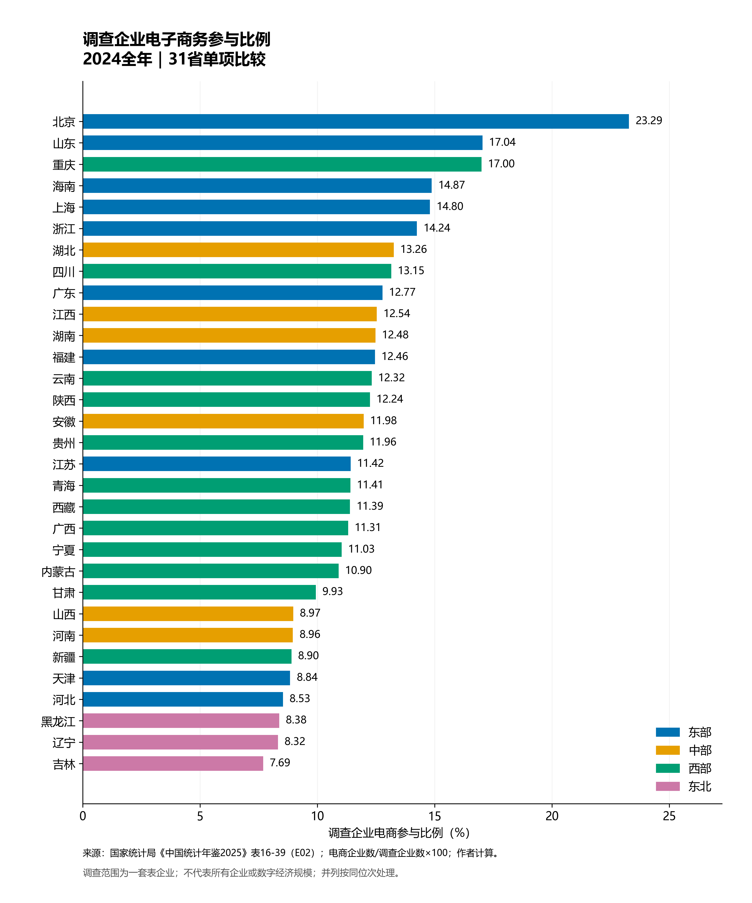
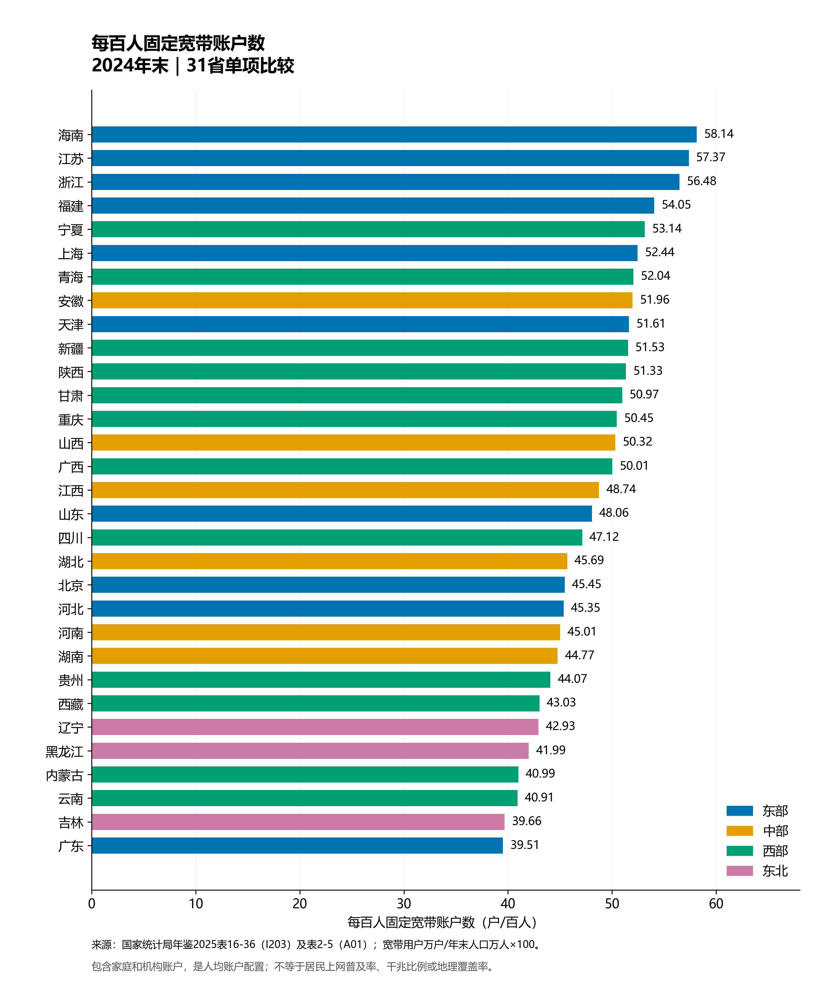
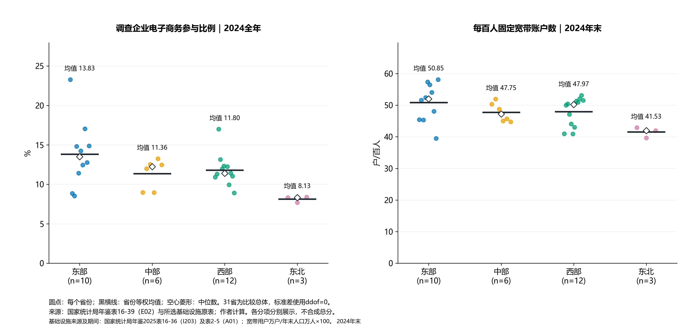
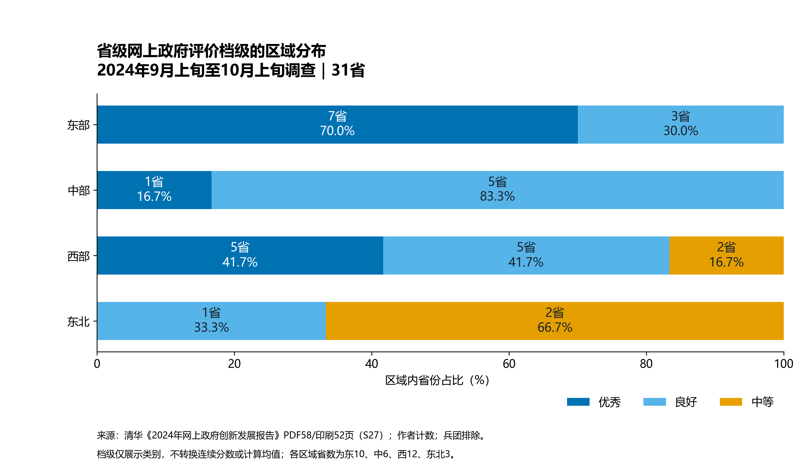

# 第二阶段分项预分析

本报告仅比较各分项，不生成数字现代化总分。排序采用未四舍五入原值，若并列取相同最小名次；图中文字保留两位小数。区域均值为省份等权均值，企业加权比例另列，不混称。

## 01_ecommerce_share_2024

2024年调查企业电商参与比例中，北京为23.29%，吉林为7.69%，相差15.60个百分点。这里比较的是调查企业应用比例，不能解释为数字经济规模或所有企业普及率。

## 02_infrastructure_single_indicator

2024年末，每百人固定宽带账户数最高为海南（58.14户/百人），最低为广东（39.51户/百人）。该结果只对应这一设施代理，不能代表整个数字基础设施维度。

## 03_regional_distributions

按省份等权均值，电商参与比例的区域顺序为东部、西部、中部、东北，基础设施代理的顺序为东部、西部、中部、东北。电商区域内极差最大的是东部（14.75个百分点），显示区域均值不能替代省份分布。不同统计期仅作探索对照。

## 04_government_categories_2024

31省网上政府档级为优秀13省、良好14省、中等4省。区域图按各区域省数计算占比，东北只有3省。档级用于类别比较，不能推出档内排序、精确得分或区域平均政府分。

## 结构差异与候选案例

两个连续分项的省际Spearman相关系数为0.267，仅作描述性探索；统计期不同，不能解释为严格同期关系，更不能推断因果。案例候选按两项单指标名次绝对差前6位选出，数据见case_candidates.csv；尚未确定最终案例。

|省份|区域|电商比例%|电商单项名次|设施代理值|设施单项名次|名次差（电商−设施）|
|---|---|---:|---:|---:|---:|---:|
|广东|东部|12.77|9|39.51|31|-22|
|北京|东部|23.29|1|45.45|20|-19|
|天津|东部|8.84|27|51.61|9|18|
|云南|西部|12.32|13|40.91|29|-16|
|新疆|西部|8.90|26|51.53|10|16|
|宁夏|西部|11.03|21|53.14|5|16|

候选只提示两个代理指标不同步，不能称发展失衡或成功路径。后续须结合原统计范围、行业结构与官方案例材料解释。区域统计、类别计数、完整31省值及脚本均保留，未对档级进行数值化。
